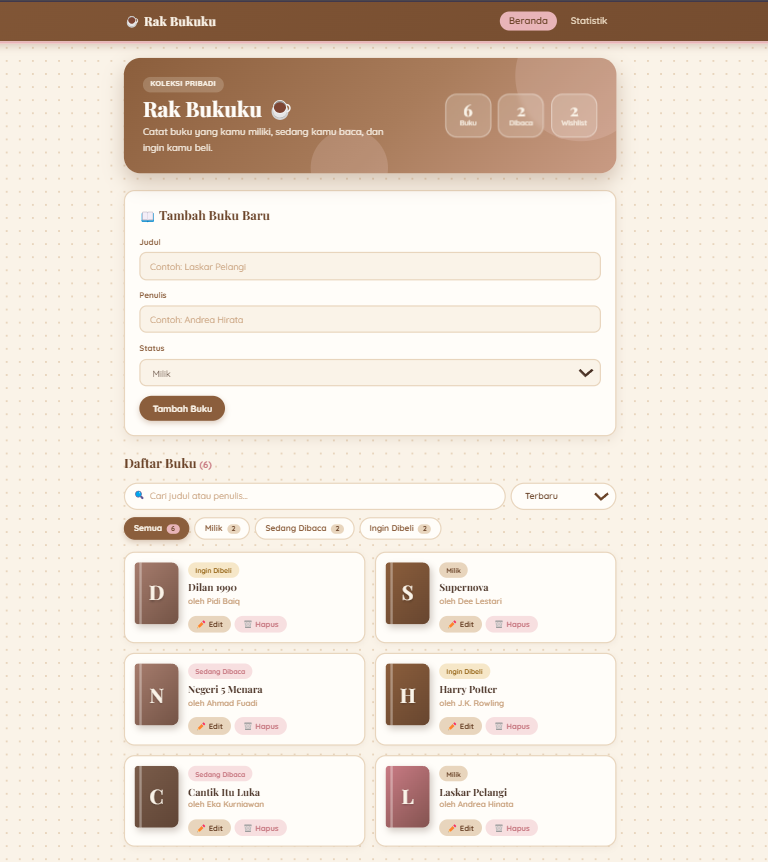
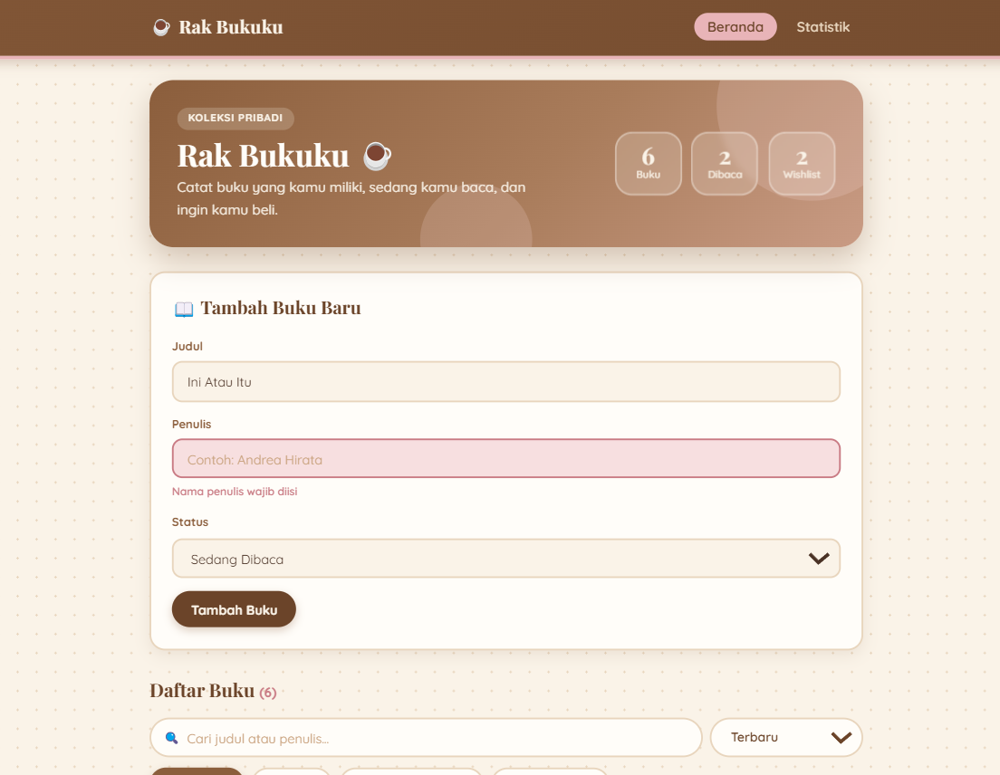
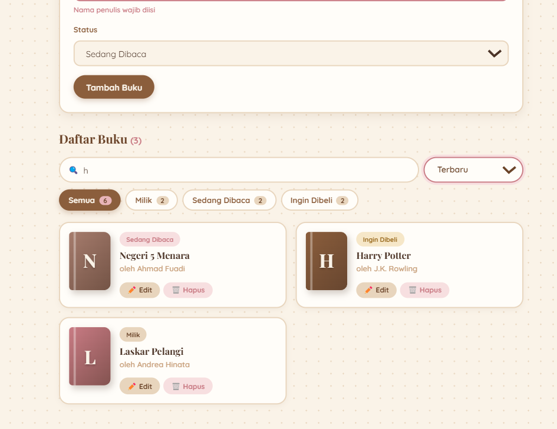
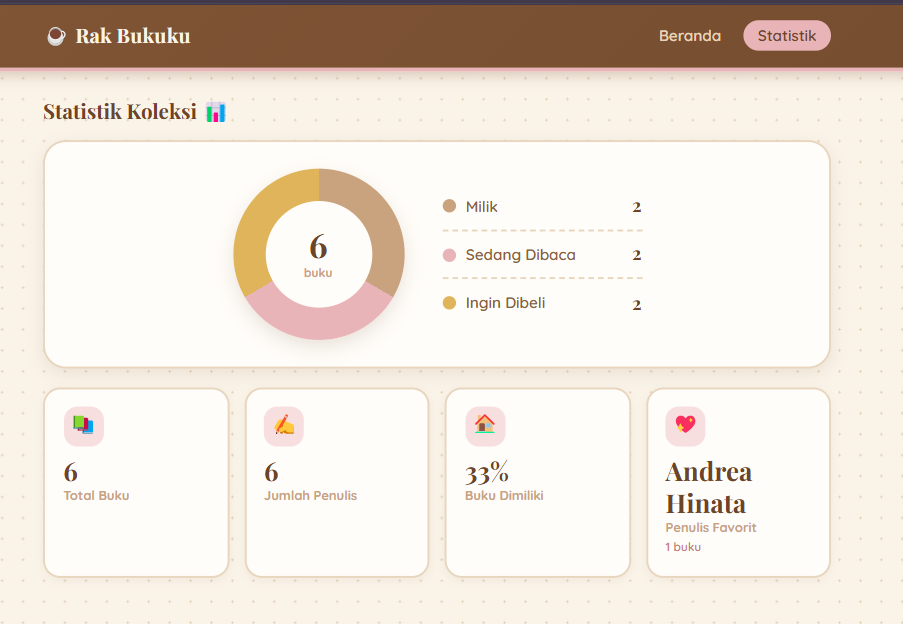
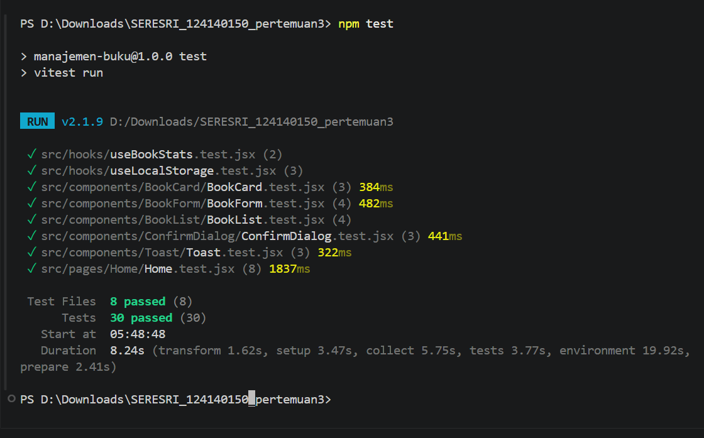

# 📚 Aplikasi Manajemen Buku Pribadi

Tugas Pertemuan 3 — Pemrograman Web (React Basics)

**Nama:** Sere Sri Rezeki Sinaga  
**NIM:** 124140150

## Deskripsi Aplikasi

Aplikasi web untuk mencatat koleksi buku pribadi. Setiap buku memiliki **judul**, **penulis**, dan **status**:

- **Milik** — buku yang sudah dimiliki
- **Sedang Dibaca** — buku yang sedang dibaca
- **Ingin Dibeli** — daftar buku incaran

Data tersimpan otomatis di `localStorage`, sehingga tidak hilang saat halaman di-refresh.

## Fitur

**Fitur utama (sesuai ketentuan tugas)**

- Tambah buku baru (judul, penulis, status)
- Edit dan hapus buku
- Filter buku berdasarkan status (chip dengan jumlah buku per status)
- Pencarian berdasarkan judul atau nama penulis (tidak peka huruf besar/kecil)
- Validasi form: kolom wajib diisi, dengan pesan error dan highlight pada kolom kosong
- Penyimpanan persisten dengan `localStorage`

**Pengalaman pengguna tambahan**

- Hero banner berisi ringkasan jumlah buku
- Kartu buku dengan sampul berwarna (warna ditentukan dari judul) dan animasi halus
- Pengurutan: terbaru, judul A-Z, atau penulis A-Z
- Dialog konfirmasi sebelum menghapus buku (bisa ditutup dengan Escape)
- Notifikasi toast setelah menambah, mengubah, atau menghapus buku
- Halaman Statistik dengan donut chart komposisi status, jumlah penulis, persentase buku dimiliki, dan penulis favorit
- Halaman 404 untuk URL yang tidak dikenal
- Tema visual cream mocha, responsif untuk layar HP

## Instalasi dan Cara Menjalankan

Prasyarat: Node.js LTS (v18 atau v20 ke atas) dan npm. Cek dengan `node --version` dan `npm --version`.

**Langkah di VS Code**

1. Buka folder project di VS Code (File → Open Folder).
2. Buka terminal terintegrasi (menu Terminal → New Terminal).
3. Jalankan perintah berikut:

```bash
# 1. Pasang dependensi
npm install

# 2. Jalankan development server
npm run dev
# buka alamat yang tampil di terminal (biasanya http://localhost:5173)
# hentikan server dengan Ctrl + C

# 3. Jalankan unit test
npm test

# 4. Build untuk produksi (opsional)
npm run build
```

## Screenshot Antarmuka

### Beranda


### Validasi Form (input kosong)


### Filter dan Pencarian


### Halaman Statistik


## Struktur Folder

```
src/
├── components/
│   ├── BookForm/      # form tambah/edit + validasi
│   ├── BookList/      # grid daftar buku + empty state
│   ├── BookCard/      # kartu satu buku (sampul, badge, aksi)
│   ├── BookFilter/    # pencarian + chip filter status + urutan
│   ├── ConfirmDialog/ # dialog konfirmasi hapus
│   ├── Toast/         # notifikasi singkat
│   └── Navbar/        # navigasi antar halaman
├── pages/
│   ├── Home/          # halaman utama (hero, CRUD, filter, cari, urut)
│   └── Stats/         # halaman statistik (donut chart + kartu)
├── hooks/
│   ├── useLocalStorage.js   # custom hook #1
│   └── useBookStats.js      # custom hook #2
├── context/
│   └── BookContext.jsx      # state global (Context API)
├── App.jsx            # router + provider
└── main.jsx           # entry point
```

## Fitur React yang Digunakan

| Konsep | Penerapan |
| --- | --- |
| Functional components | Seluruh komponen berupa fungsi |
| `useState` | State form, input pencarian, filter status, buku yang sedang diedit |
| `useEffect` | Sinkronisasi `localStorage` (`useLocalStorage`), reset form saat mode edit berganti (`BookForm`), timer penutup otomatis (`Toast`), dan listener tombol Escape (`ConfirmDialog`) dengan fungsi cleanup |
| `useMemo` / `useCallback` | Penyaringan dan pengurutan daftar buku di `Home`, perhitungan statistik di `useBookStats`, dan fungsi penutup toast yang stabil |
| `useRef` | Menjaga ID buku selalu unik dan berurutan di `BookContext` |
| Props & callback | `BookList`, `BookCard`, `BookFilter`, `BookForm`, `Toast`, `ConfirmDialog` menerima data/aksi dari parent |
| Controlled components | Semua input form dan kolom pencarian |
| Conditional rendering | Pesan error, empty state, tombol Batal pada mode edit, dialog dan toast yang muncul sesuai kondisi |
| Rendering list + `key` | `books.map(...)` dengan `key={book.id}`, juga untuk chip filter dan legenda statistik |
| Context API | `BookContext` (`BookProvider` + hook `useBooks`) menyediakan `books`, `addBook`, `updateBook`, `deleteBook` |
| Custom hooks | `useLocalStorage` dan `useBookStats` (total, per status, penulis unik, penulis favorit, persentase) |
| React Router | Rute `/` (Beranda), `/stats` (Statistik), `*` (404) dengan `NavLink` |
| PropTypes | Type checking di semua komponen yang menerima props |
| Error handling | Validasi form dengan feedback visual + `try/catch` pada akses `localStorage` |

## Pengujian

Pengujian memakai **Vitest** dan **React Testing Library**: 30 test di 8 file.

| File | Cakupan |
| --- | --- |
| `BookForm.test.jsx` | Validasi, feedback error, submit, mode edit |
| `BookList.test.jsx` | Render daftar, pesan kosong, aksi edit/hapus |
| `BookCard.test.jsx` | Render kartu, warna sampul konsisten, aksi edit/hapus |
| `ConfirmDialog.test.jsx` | Render dialog, konfirmasi, batal, tombol Escape |
| `Toast.test.jsx` | Render pesan, tutup otomatis, tombol tutup |
| `useBookStats.test.jsx` | Perhitungan statistik dan penulis favorit |
| `useLocalStorage.test.jsx` | Baca, tulis, nilai awal |
| `Home.test.jsx` | Integrasi: tambah, filter, cari, urut, edit, hapus + batal, toast |

Jalankan seluruh test dengan:

```bash
npm test
```

### Laporan Testing

Hasil eksekusi unit test di terminal:



