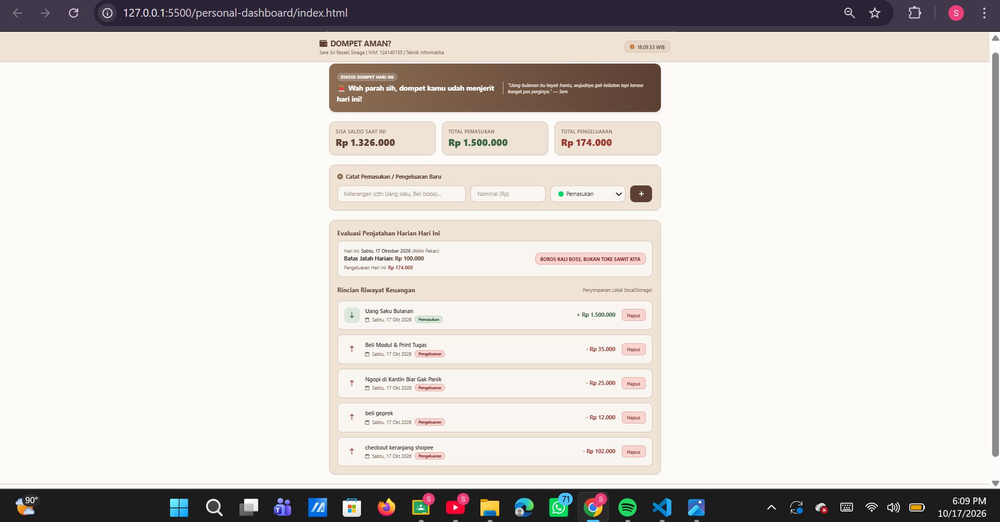
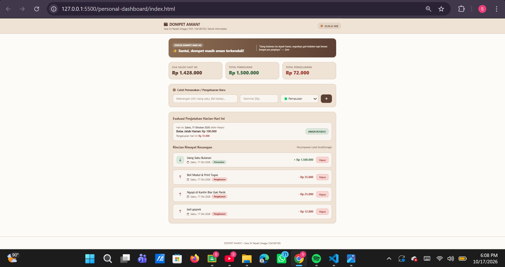

# DOMPET AMAN? - ITERA Student Budgeting & Penjatahan

## 📌 Penjelasan Singkat
**DOMPET AMAN?** adalah aplikasi web pencatat keuangan dan penjatahan harian pintar yang dirancang khusus untuk kaum mahasiswa [cite: 1]. Aplikasi ini membantu mengontrol pengeluaran harian berdasarkan batas jatah otomatis (hari kerja vs akhir pekan), menghitung sisa saldo secara real-time, serta mendeteksi apakah pengeluaran hari ini masuk kategori "AMAN BOSKUU" atau "BOROS KALI BOSS, BUKAN TOKE SAWIT KITA"[cite: 1].

## 🚀 Fitur Utama
1. **Evaluasi Penjatahan Harian Otomatis**: 
   - Senin – Jumat: Batas maksimal pengeluaran **Rp 50.000 / hari**.
   - Sabtu – Minggu: Batas maksimal pengeluaran **Rp 100.000 / hari**.
2. **Status Keuangan Gaul & Kocak**: Menampilkan indikator status dompet secara interaktif berdasarkan perbandingan pengeluaran harian dan kuota.
3. **Ringkasan Finansial Real-Time**: Kalkulasi otomatis total pemasukan, total pengeluaran, dan sisa saldo saat ini[cite: 1].
4. **Widget Jam Real-Time & Kutipan Gaul**: Dilengkapi penunjuk waktu WIB dan kata-kata motivasi/humor ala mahasiswa teknik.
5. **Penyimpanan Lokal (`localStorage`)**: Seluruh data transaksi tersimpan secara aman di peramban web pengguna[cite: 1].

## 🛠️ Daftar Fitur ES6+ yang Diimplementasikan
- **`let` & `const`**: Digunakan secara konsisten untuk deklarasi variabel[cite: 1].
- **Arrow Functions**: Diimplementasikan lebih dari 3 kali (contoh: `loadFromLocalStorage`, `render`, `startClock`, dll.)[cite: 1].
- **Template Literals**: Digunakan untuk rendering dinamis riwayat transaksi dan kotak evaluasi harian[cite: 1].
- **Asynchronous Functions (`async/await` & `Promise.all`)**: Mengelola pemanggilan data asinkron pada inisialisasi aplikasi[cite: 1].
- **Classes**: Pemodelan berbasis objek modern menggunakan `class TransactionItem` dan `class BudgetingApp`[cite: 1].
- **Destructuring & Spread Operator**: Digunakan saat memperbarui state array transaksi secara *immutable* (`[...this.transactions, newItem]`)[cite: 1].

## 📸 Screenshot Tampilan Aplikasi

Berikut adalah tampilan antarmuka dari aplikasi **DOMPET AMAN?**:

## 👤 Identitas Pembuat
- **Nama**: Sere Sri Rezeki Sinaga[cite: 1]
- **NIM**: 124140150[cite: 1]
- **Program Studi**: Teknik Informatika[cite: 1]
- **Institusi**: Institut Teknologi Sumatera (ITERA)[cite: 1]
- **Email**: `sere.124140150@student.itera.ac.id`[cite: 1]