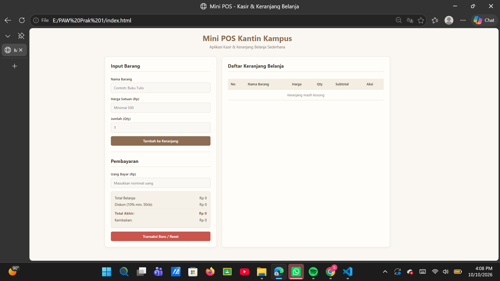
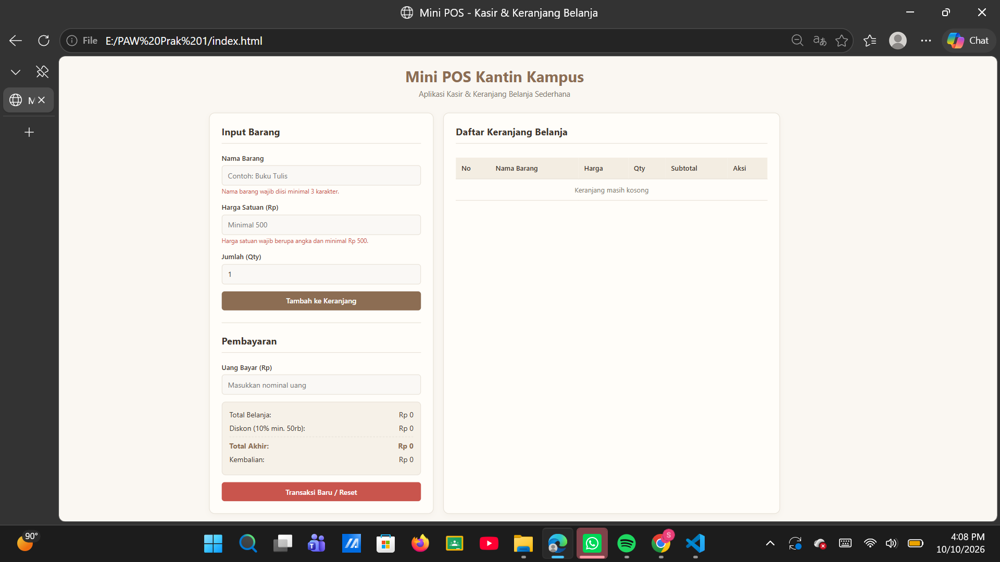
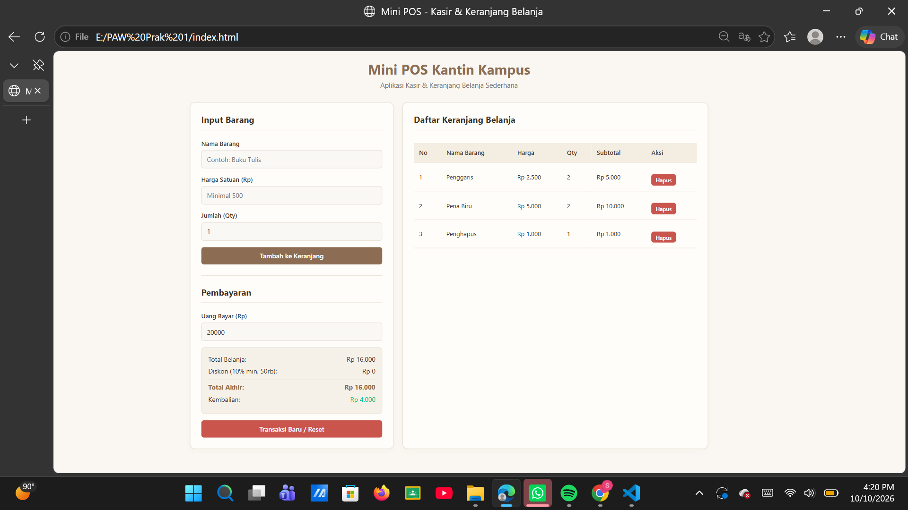

# Laporan Tugas Praktikum Pemrograman Web - Mini POS

## Identitas
- **Nama Lengkap:** Sere Sri Rezeki Sinaga
- **NIM:** 124140150
- **Kelas Praktikum:** RA

---

## Deskripsi Aplikasi
Aplikasi **Mini POS (Point of Sale)** adalah aplikasi web sederhana yang dirancang khusus untuk kebutuhan transaksi kasir kantin atau toko kampus. Tujuan pembuatan aplikasi ini adalah untuk mengimplementasikan tiga kompetensi utama pengembangan web: **validasi input form**, **kalkulator finansial otomatis**, dan **manajemen data persisten berbasis `localStorage`**. 

Studi kasus yang dipilih adalah sistem kasir kantin kampus yang mencakup proses input barang belanjaan, pengecekan batas minimum harga dan kuantitas, kalkulasi diskon otomatis, serta pengelolaan riwayat keranjang belanja secara interaktif.

---

## Panduan Menjalankan
Langkah-langkah berikut adalah untuk menjalankan aplikasi di komputer lokal:
1. Pastikan telah menginstal teks editor seperti **Visual Studio Code (VS Code)** dan browser web (Chrome/Firefox/Edge).
2. Clone atau download repository proyek ini ke perangkat.
3. Buka folder proyek melalui VS Code.
4. Jika menggunakan VS Code, disarankan menginstal ekstensi **Live Server**.
5. Klik kanan pada file `index.html`, lalu pilih **"Open with Live Server"**, atau cukup klik dua kali pada file `index.html` untuk membukanya langsung di browser.

---

## Daftar Fitur
Berikut adalah checklist fitur yang berhasil diimplementasikan pada aplikasi ini:
- [x] **Validasi Form Input Barang:**
  - Nama barang wajib diisi minimal 3 karakter.
  - Harga satuan wajib berupa angka positif dan minimal Rp 500.
  - Jumlah (Qty) wajib berupa angka bulat minimal 1.
  - Feedback pesan error berwarna merah jika input tidak valid.
- [x] **Kalkulator & Perhitungan Otomatis:**
  - Kalkulasi subtotal otomatis per baris barang ($Harga \times Qty$).
  - Kalkulasi total belanja secara akumulatif.
  - Kalkulator diskon otomatis 10% untuk total belanja minimal Rp 50.000.
  - Kalkulator uang bayar dan kembalian otomatis (disertai peringatan jika uang kurang).
- [x] **Manajemen Keranjang & LocalStorage:**
  - Tabel keranjang belanja interaktif dengan tombol hapus per baris.
  - Penyimpanan data persisten menggunakan `localStorage` dengan metode `JSON.stringify()` dan `JSON.parse()`.
  - Tombol **Transaksi Baru / Reset** untuk mengosongkan keranjang dan membersihkan penyimpanan lokal.
- [x] **Desain Antarmuka (UI/UX):**
  - Mengusung tema warna *Cream / Warm Neutral* yang bersih, elegan, dan nyaman di mata.
  - Format angka otomatis ter-styling ke dalam format mata uang Rupiah (IDR).

---

## Tangkapan Layar (Screenshot)

### 1. Tampilan Form Input Utama

### 2. Tampilan Saat Validasi Error Muncul

### 3. Tampilan Hasil Kalkulator & Tabel Keranjang Belanja

---

## Penjelasan Teknis Singkat
Alur logika utama pada file `script.js` dibangun menggunakan 3 mekanisme utama:
1. **Penanganan Validasi Input:** Saat form disubmit (`submit` event), JavaScript memvalidasi nilai input secara kondisional. Jika ditemukan nilai yang tidak memenuhi syarat (misal nama $< 3$ karakter atau harga $< 500$), teks error ditampilkan pada elemen `<small>` dan perintah `e.preventDefault()` mencegah data masuk ke keranjang. Jika valid, form otomatis di-reset.
2. **Algoritma Kalkulator Keuangan:** Total belanja dihitung secara dinamis menggunakan perulangan/metode array untuk mengakumulasikan subtotal. Jika total mencapai syarat minimal, potongan diskon 10% dikurangkan secara otomatis dari total akhir. Nilai uang kembalian dihitung secara real-time saat kasir mengetikkan nominal pada input uang bayar, lengkap dengan validasi kecukupan dana.
3. **Mekanisme Serialisasi `LocalStorage`:** Setiap kali item ditambahkan atau dihapus dari array `cart`, data array dikonversi menjadi string teks JSON menggunakan `JSON.stringify()` dan disimpan ke dalam memori browser (`localStorage.setItem`). Saat halaman dimuat ulang (`DOMContentLoaded`), data diambil kembali dan diurai menggunakan `JSON.parse()` (`localStorage.getItem`), sehingga riwayat keranjang tetap aman dan tidak hilang.