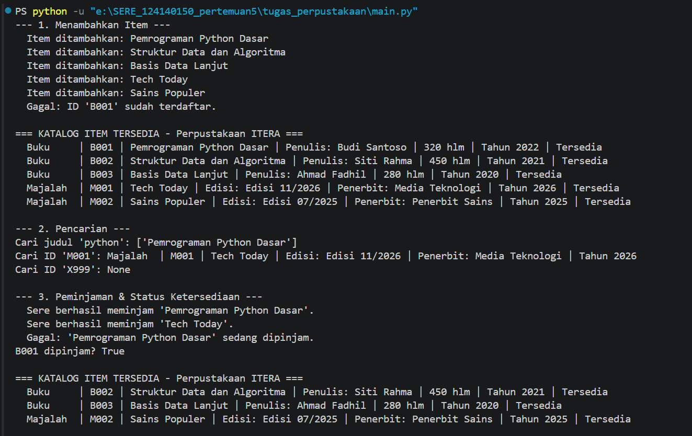
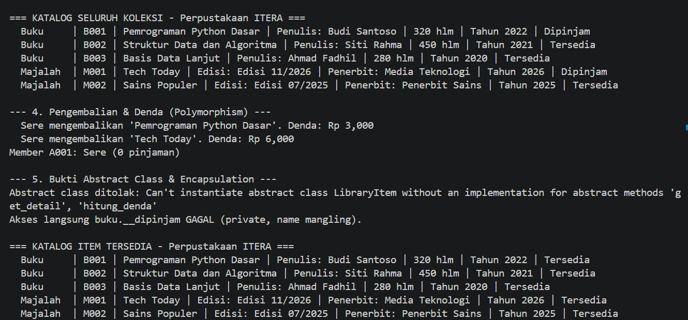

# Praktikum Pemrograman Web - Pertemuan 5: Python OOP

## Identitas Mahasiswa

| | |
|---|---|
| Nama Lengkap | Sere Sri Rezeki Sinaga |
| NIM | 124140150 |
| Kelas Praktikum | RA |

## Deskripsi Program

Program ini adalah **Sistem Manajemen Perpustakaan Sederhana** yang ada di folder `tugas_perpustakaan/`.

Alur program (`main.py`):
1. Membuat objek `Library`, lalu menambahkan beberapa `Book` dan `Magazine` ke dalamnya. ID yang duplikat ditolak.
2. Menampilkan katalog item yang tersedia.
3. Mencari item berdasarkan judul dan berdasarkan ID.
4. Seorang `Member` meminjam item, lalu katalog diperbarui sesuai status ketersediaan.
5. Item dikembalikan dan denda keterlambatan dihitung.
6. Membuktikan bahwa abstract class tidak bisa diinstansiasi dan atribut private terlindungi.

Struktur berkas:

| Berkas | Isi |
|---|---|
| `library_item.py` | Abstract class `LibraryItem`, subclass `Book` dan `Magazine` |
| `member.py` | Class `Member` (anggota, maksimal 3 pinjaman) |
| `library.py` | Class `Library` (menyimpan koleksi, menampilkan katalog, mencari item) |
| `main.py` | Skrip untuk menguji seluruh fitur |

### Penerapan 4 Pilar OOP

- **Class**: `LibraryItem`, `Book`, `Magazine`, `Member`, dan `Library` masing-masing membungkus data dan perilakunya sendiri.
- **Inheritance**: `Book` dan `Magazine` mewarisi `LibraryItem` dan memanggil `super().__init__()`. Method `pinjam()`, `kembalikan()`, dan `__str__()` diwariskan dari parent.
- **Encapsulation**: Atribut `__dipinjam` (private) di `LibraryItem`, `__koleksi` (private) di `Library`, dan `__daftar_pinjam` (private) di `Member`, serta `_item_id`, `_judul`, `_tahun` (protected). Data hanya bisa diubah lewat method. Decorator `@property` dipakai pada `is_dipinjam`, `item_id`, `judul`, `tahun`, `jumlah_item`, dan `jumlah_pinjaman`.
- **Polymorphism**: `get_detail()` dan `hitung_denda()` adalah abstract method yang diimplementasikan berbeda oleh tiap subclass (denda buku Rp 1.000/hari, majalah Rp 2.000/hari). `Library.tampilkan_katalog()` dan `Member.kembalikan_item()` memanggilnya tanpa pengecekan tipe dengan `if-elif`.
- **Abstraction**: `LibraryItem` mewarisi `ABC` dan memakai `@abstractmethod`, sehingga tidak bisa diinstansiasi langsung.

## Panduan Menjalankan Program

Membutuhkan Python 3.10 atau lebih baru.

```bash
cd tugas_perpustakaan
python main.py
```

## Screenshot Output





Screenshot di atas menunjukkan fitur penambahan item, penampilan katalog, pencarian berdasarkan judul dan ID, serta peminjaman dan pengembalian item.