# Pyramid Mahasiswa & Matakuliah — RESTful API

## Identitas Praktikan

| | |
|---|---|
| **Nama Lengkap** | Sere Sri Rezeki Sinaga |
| **NIM** | 124140150 |
| **Kelas Praktikum** | RA / RB *(isi sesuai kelas Anda)* |
| **Mata Kuliah** | Pemrograman Web |
| **Pertemuan** | 6 — Pyramid Framework, PostgreSQL & SQLAlchemy |

## Deskripsi Aplikasi

Aplikasi RESTful API berbasis **Pyramid** dengan database **PostgreSQL**
(SQLAlchemy ORM + migrasi Alembic). Terdiri dari dua modul CRUD:

- **Mahasiswa** (`/api/mahasiswa`) — dari praktikum.
- **Matakuliah** (`/api/matakuliah`) — tugas pertemuan ini.

Tabel `matakuliah`: `id` (PK, autoincrement), `kode_mk` (unique, not null),
`nama_mk`, `sks`, `semester`. Kolom `sks` dan `semester` divalidasi harus
bilangan bulat **> 0** (di view dan juga lewat `CHECK` constraint di database).

### Endpoint

| Method | URL | Keterangan | Status |
|---|---|---|---|
| GET | `/api/matakuliah` | Daftar seluruh mata kuliah | 200 |
| GET | `/api/matakuliah/{id}` | Detail mata kuliah | 200 / 404 |
| POST | `/api/matakuliah` | Tambah mata kuliah (wajib: `kode_mk`, `nama_mk`, `sks`, `semester`) | 200 / 400 |
| PUT | `/api/matakuliah/{id}` | Ubah data mata kuliah (parsial) | 200 / 400 / 404 |
| DELETE | `/api/matakuliah/{id}` | Hapus mata kuliah | 200 / 404 |

Endpoint `/api/mahasiswa` memiliki pola yang sama.

## Instalasi & Menjalankan

Prasyarat: Python 3.10/3.11 dan PostgreSQL.

### 1. Virtual environment & dependensi

```bash
python3 -m venv venv
source venv/bin/activate          # Windows: venv\Scripts\activate.bat
pip install --upgrade pip setuptools
pip install -e ".[testing]"
```

### 2. Siapkan database PostgreSQL

```sql
CREATE DATABASE pyramid_mahasiswa;
CREATE USER pyramid_user WITH ENCRYPTED PASSWORD 'pyramid_pass';
GRANT ALL PRIVILEGES ON DATABASE pyramid_mahasiswa TO pyramid_user;
\c pyramid_mahasiswa
GRANT ALL ON SCHEMA public TO pyramid_user;
```

Connection string ada di `development.ini` (`sqlalchemy.url`).

### 3. Migrasi database (Alembic)

```bash
alembic -c development.ini upgrade head
```

Dua revisi diterapkan: `create mahasiswa table` dan `create matakuliah table`.
Untuk membuat revisi baru dari perubahan model:
`alembic -c development.ini revision --autogenerate -m "pesan"`.

### 4. Seeding data awal

```bash
python -m pyramid_mahasiswa.scripts.initialize_db development.ini
```

Menambahkan 2 mahasiswa dan 4 mata kuliah (IF2110, IF3140, IF2120, IF3130).
Skrip aman dijalankan berulang kali (data yang sudah ada dilewati).

### 5. Jalankan server

```bash
pserve development.ini --reload
```

Server berjalan di <http://localhost:6543>.

### 6. (Opsional) Jalankan unit test

```bash
pytest
```

Test memakai SQLite sementara, jadi tidak menyentuh database PostgreSQL.

## Pengujian dengan cURL

```bash
# READ ALL
curl -X GET http://localhost:6543/api/matakuliah

# READ ONE
curl -X GET http://localhost:6543/api/matakuliah/1

# CREATE
curl -X POST http://localhost:6543/api/matakuliah \
  -H "Content-Type: application/json" \
  -d '{"kode_mk":"IF3150","nama_mk":"Rekayasa Perangkat Lunak","sks":3,"semester":5}'

# VALIDASI (400) — field kode_mk tidak ada
curl -X POST http://localhost:6543/api/matakuliah \
  -H "Content-Type: application/json" \
  -d '{"nama_mk":"Tanpa Kode","sks":3,"semester":5}'

# VALIDASI (400) — sks = 0
curl -X POST http://localhost:6543/api/matakuliah \
  -H "Content-Type: application/json" \
  -d '{"kode_mk":"IF9999","nama_mk":"SKS Nol","sks":0,"semester":5}'

# UPDATE
curl -X PUT http://localhost:6543/api/matakuliah/1 \
  -H "Content-Type: application/json" \
  -d '{"sks":4,"semester":4}'

# DELETE
curl -X DELETE http://localhost:6543/api/matakuliah/5

# NOT FOUND (404)
curl -X GET http://localhost:6543/api/matakuliah/5
```

Contoh respons yang diharapkan:

| Skenario | Status | Respons |
|---|---|---|
| READ ALL | 200 | `{"matakuliahs": [{"id": 1, "kode_mk": "IF2110", ...}, ...]}` |
| CREATE | 200 | `{"success": true, "matakuliah": {"id": 5, "kode_mk": "IF3150", ...}}` |
| Field wajib kosong | 400 | `{"error": "Field kode_mk wajib diisi!"}` |
| `sks` = 0 | 400 | `{"error": "Field sks harus lebih besar dari 0"}` |
| UPDATE | 200 | `{"success": true, "matakuliah": {"id": 1, ..., "sks": 4, "semester": 4}}` |
| DELETE | 200 | `{"success": true, "message": "Mata kuliah dengan ID 5 berhasil dihapus"}` |
| ID tidak ada | 404 | `{"error": "Mata kuliah dengan ID 5 tidak ditemukan"}` |

## Bukti Pengujian (Screenshot)

> Letakkan tangkapan layar hasil pengujian cURL/Postman Anda di folder
> `screenshots/` dengan nama berikut, lalu pastikan gambar tampil di bawah.

### Mahasiswa

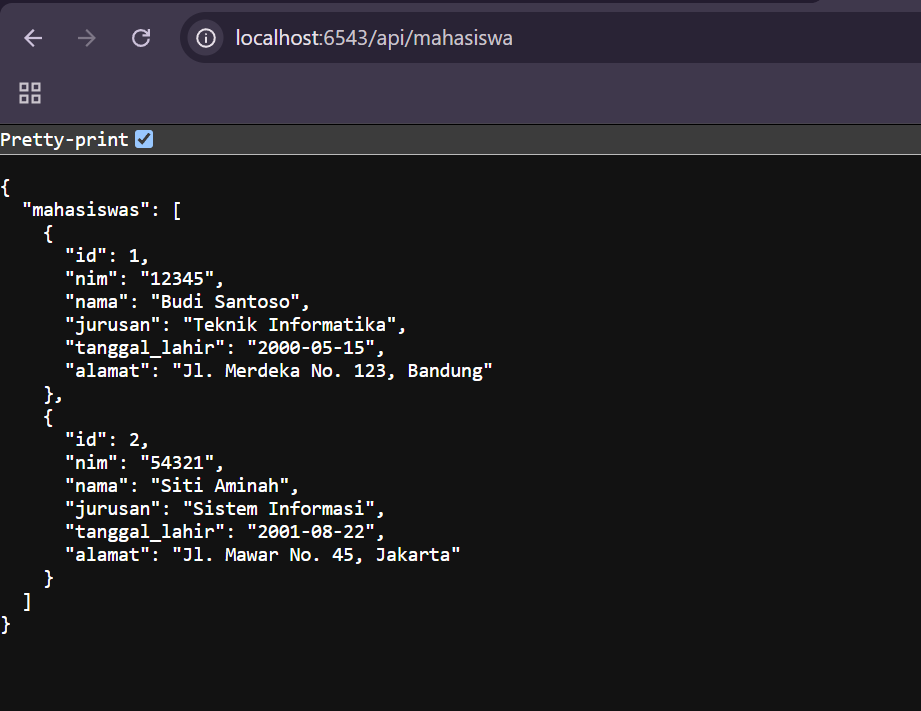
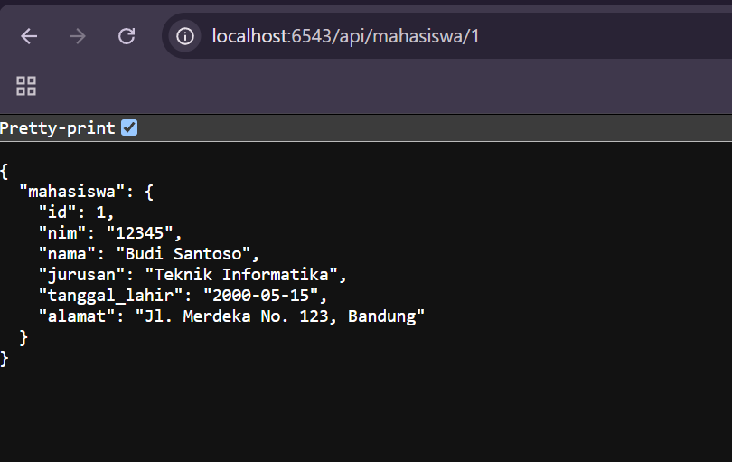
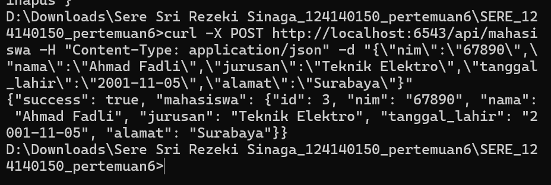
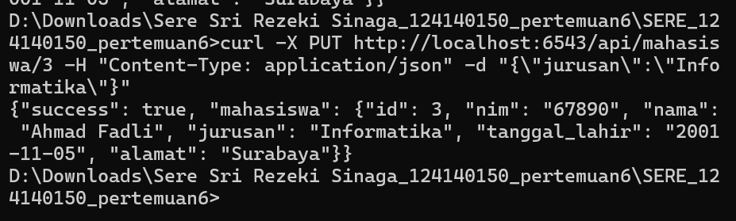
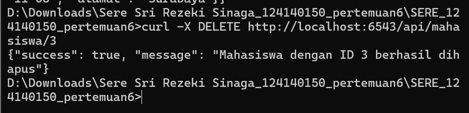
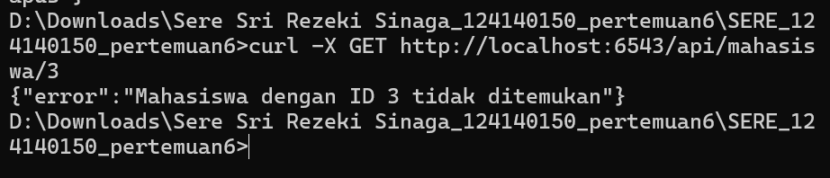

### Matakuliah

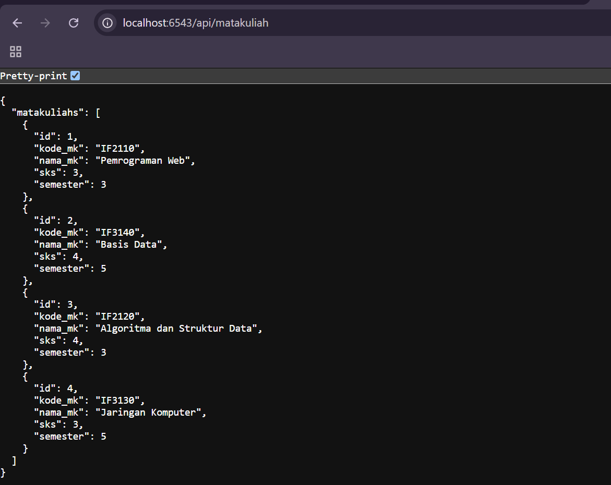
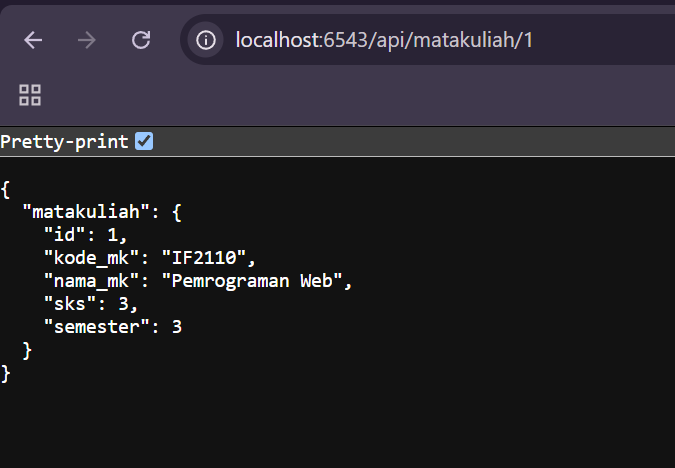
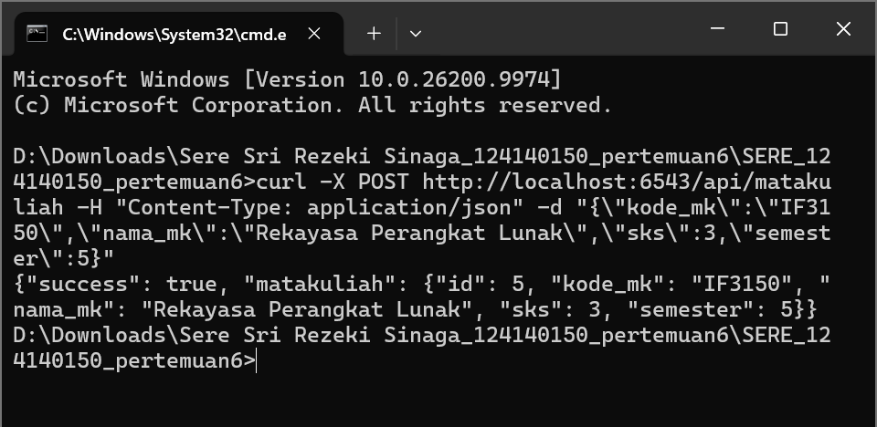
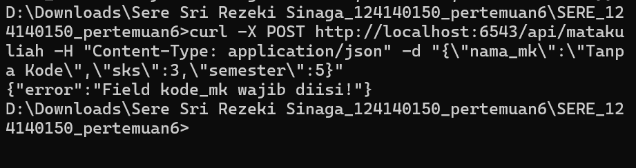
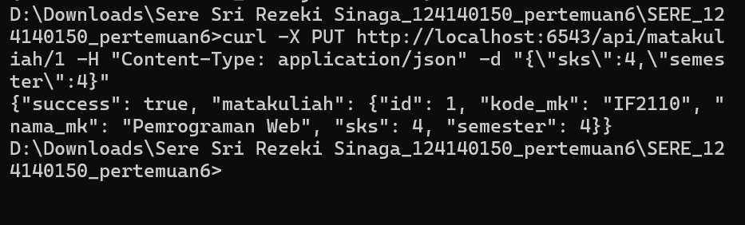
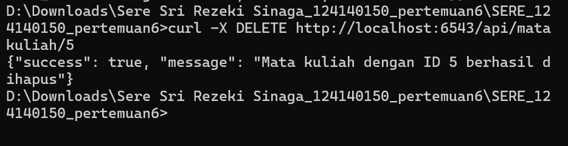
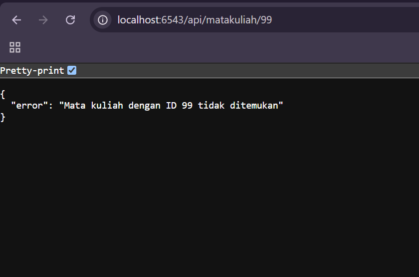

## Struktur Proyek

```
.
├── development.ini
├── production.ini
├── setup.py
├── README.md
├── .gitignore
└── pyramid_mahasiswa/
    ├── __init__.py          # entry point WSGI
    ├── routes.py            # URL dispatch + request_method
    ├── alembic/             # env.py + versions/ (2 revisi)
    ├── models/              # meta, mahasiswa, matakuliah
    ├── scripts/             # initialize_db.py (seeding)
    ├── tests/               # unit test (pytest + WebTest)
    └── views/               # default, mahasiswa, matakuliah
```
